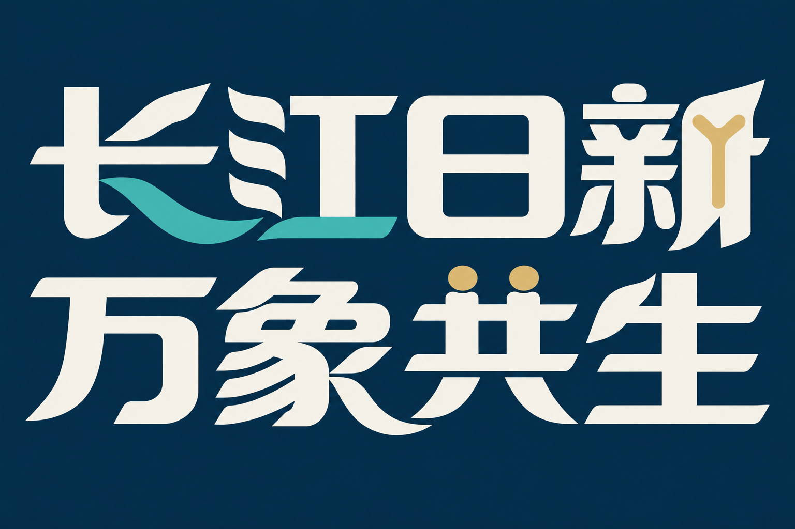
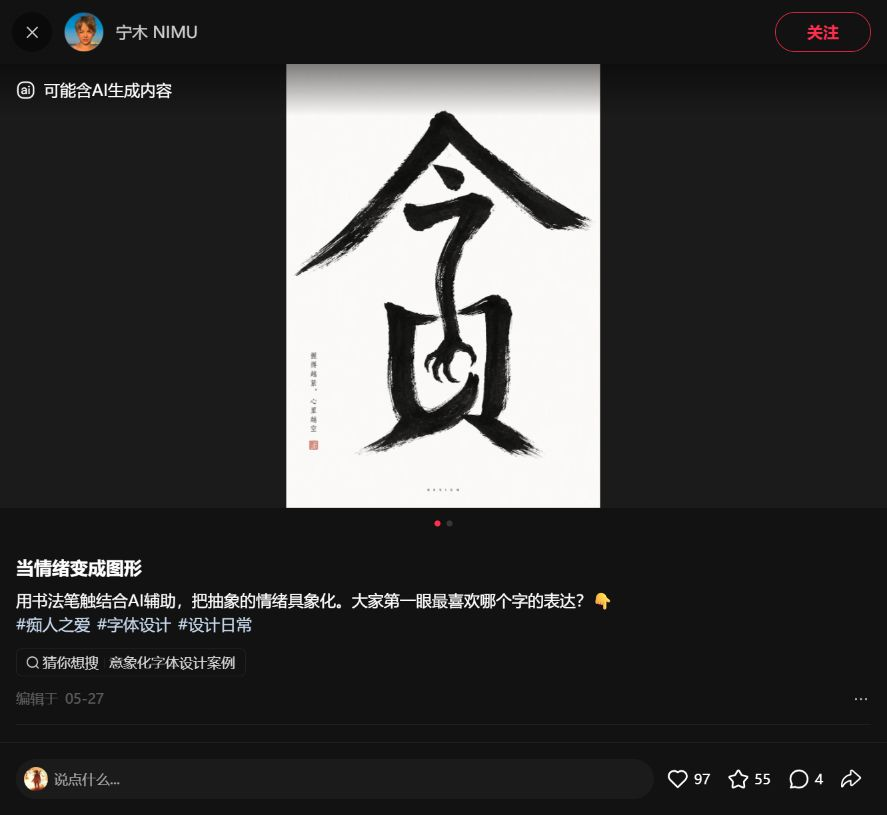

# 汉字创意再研究：失败复盘与方法更新

研究日期：2026-10-21。对象：长江商学院主题“长江日新 万象共生”的两轮设计检验。

本轮任务是反思、重新查阅与总结，没有再次生成设计图。用户明确否定上一轮的新意与表达力度，这个反馈是本项目的实际验收结果。前轮字数准确、文件保存成功与样稿可读，均不能改变该结果。

[案例与证据索引](02-案例研究与证据索引.md) · [下次创作工作单](03-下次创作工作单.md)

## 一、这次错在什么地方

### 1. 我理解错了“重构”的强度

用户原稿已经有强烈的书写性：长、象的捺跨出字面，飞白贯通横向空间；新字的竖向收笔与其他字形成高低变化。用户希望沿着这种气质继续突破，得到夸张、独特、具有意象的主题大字。

第二轮我改成等大、齐边、宽厚的几何字，换成两行四字，又用统一切角与圆弧作主要变化。它可以作为某类稳健字标的方向，却缩小了本题最值得发展的书写张力。我的判断把“整齐与规整”摆到了用户要求的“个性与强表达”前面。

原稿参见本对话中的用户附件。本轮已重新查看其完整画面；报告保留下方被否定的版本作为复盘对照，不重建或仿造原图。

### 2. 我依赖了用户的创意，没有提出足够独立的视觉构想

长江→水流，新→科技节点，共→两个人，这三个对应关系基本沿着用户已给的提示展开。我改变了它们的画法，没有充分发现新的关系。

尤其“新”的节点与Y形分叉，是一种泛化的创新符号；把同一符号换到科技、教育、环保等主题上，解释仍大致成立。它与“日新”的时间性、与长江的文化语境、与八字整体的关系，都不够紧密。

### 3. 学习停在“方法名称”，没有变成画面操作

此前研究已记录动作隐喻、整体轮廓、跨字组合、古文字转译、空间和动态。但制作时，我过早把方法收敛成“保留骨架、局部替换”，几乎每个字都留在自己的独立格子里。

缺少的实际尝试包括：字被冲开、部件迁移到另一字、两个字争夺或共同支撑一条主笔、整体成为一个有方向的形体、旧结构在转折处生成新结构。没有这些尝试，换笔触和配色仍很难跨出原来的思路。

### 4. 我把可读性当成了过早的限制

主标题需要能被读到，但艺术化活动标题可以安排先感受、再解读的层次。先规定八字等重、结构不动、无额外形象、每字独立，已经排除了许多有价值的探索。

后续应保住必要识别线索，同时比较不同变形强度。可以通过次级清晰标题协助阅读，不能预先把主视觉全部收回安全的字框。

### 5. 我用形式一致性代替了整体意境

相同线宽、圆角和颜色，只说明字的表面相似。它们并不自动产生“万象共生”。

整组真正值得检验的是：字与字有没有相互影响？一个字的动作是否会改变另一字？局部破碎与整体聚合有没有因果关系？观众能否在画面里看到更新正在发生？上一版的多数笔画没有承担这种关系。

### 6. 我发现了弱点，却把它当成可留待下轮的小问题

我已经注意到“新”可能被看成Y、人物有图标感，仍以“方向成立，待精修”作交付判断。用户反馈说明，缺陷主要发生在概念和力度层，继续润饰边缘不足以解决。

应当把“创意薄弱”和“轮廓待精修”区分开。前者需要重新比较机制与构图，不能只加一轮局部编辑。

### 7. 把资料量与方法掌握混在了一起

前轮确实打开和核对了一批案例，但查阅数量只证明接触过材料。能否把一个案例的有效机制转成不同主题下的新关系，才是本项目需要检验的学习结果。

这次也不以新读来源数、新存截图数作为设计能力已经提高的证明。

## 二、重新理解汉字创意的底层逻辑

以下是本轮结合文字学资料、书法馆藏说明、创作者阐述与具体画面形成的工作模型，不是已经被证明适用于所有作品的理论。

### 1. 汉字提供了多层可以同时工作的材料

国家图书馆“中国记忆”的文字学介绍把形、音、义联系起来，同时区分象形、指事、会意、形声等传统解释。它提醒我：不能把所有汉字都当成原始图画，也不能把现代设计联想讲成真实字源。

设计中的“共是两个人”是现代字图同构，不能因此宣称它就是共字的历史来源。[国家图书馆：汉字的构成](https://memory.nlc.cn/topic/resource/62)

对设计而言，可操作的层次包括：

- **形**：笔画走向、部件关系、外轮廓、字内空白。
- **义**：词语表示的事物、行为、状态与关系。
- **势**：书写的速度、压力、方向、转折与字间呼应。
- **境**：文字之间、文字与空间之间形成的整体场面。
- **观看过程**：先看到什么，何时认出文字，是否在转动、翻折或运动后才显现另一层含义。

新意可以从其中两层或多层的冲突、重叠、转换中发生。只调整“形”的外观，能形成新字体风格，但未必达到本题要求的意象重构。

### 2. 意象可以由“关系和动作”产生

本轮复看宁木NIMU的“贪”：关键不是出现了一只手，而是手从字的结构中伸出，并向内抓取。伸向何处、抓住什么、如何与下部围合空间发生关系，才使抽象情绪可见。

对本题的迁移：先研究突破、卷起、分流、汇聚、托举、让渡、互相牵引等动作，再检查它们怎样改变字形。不能只有“代表创新”“象征合作”的说明。

### 3. 狂放可以有严密的组织

故宫《自叙帖》赏析强调线条的圆转、上下翻转、轻重与行间呼应。可迁移的是组织关系；作品年代、真伪与书家经历不在此次研究的考证范围内。[故宫：《自叙帖》](https://theme.npm.edu.tw/selection/Article.aspx?sNo=04001004)

本题应把“狂放”落实为可画出来的变量：

| 变量 | 可见操作 | 应检查什么 |
| --- | --- | --- |
| 比例 | 一字占据主导，其他字形成聚散 | 主导是否有主题依据，其他字是否失去作用 |
| 倾斜与重心 | 欹斜字形由邻字或留白取得平衡 | 是否有“险而能稳”的关系 |
| 连断 | 牵引线跨字延续，实笔在关键处断开 | 视线能否继续，断裂是否有意义 |
| 疏密 | 局部压缩，另一处突然放开 | 是否形成停顿、爆发与呼吸 |
| 干湿与粗细 | 重笔蓄力，细笔加速，飞白暴露运动 | 材质是否服务笔势，是否只是均匀旧化 |
| 跨字穿插 | 长捺穿入另一字的空白或成为其支撑 | 穿插是否改变关系，是否只是加长装饰 |

“每字一样狂”容易形成噪声。需要安排聚、放、转、停，使强弱有层次。

### 4. 文化转译应产生造型规则

陈楠的甲骨文字库将古文字材料转译到固定几何网格中；学习重点是研究对象怎样约束新系统，而非拿几枚古字作装饰。几何本身并不缺乏创意，只是上一版的几何化没有充分回应本题。[陈楠访谈，清华美院](https://www.ad.tsinghua.edu.cn/info/1205/28179.htm)

“金文×山海经”的复看则提示了另一种方式：异兽的身体、角、尾与字的部件相互适应。该帖的历史字形尚未独立考证，只把可见形态作为现代创意观察。

### 5. 新意还可能来自改写阅读规则

英文方块字改变了英文词的组织方式，让观看者对文字身份的预期发生偏差；文字写生让字成为组织山水的单位。本轮查看了方块字教材与作品，文字写生主要看了展场整体并阅读作者及馆方说明，未声称逐一识别了画中的微小字。[徐冰：英文方块字](https://www.xubing.com/en/work/details/198?type=year&year=1994)；[阿什莫林博物馆：Landscripts](https://jameelcentre.ashmolean.org/collection/6980/10293/10374)

这不意味着把活动名称做成陌生符号。本题可以借鉴的是：让观众在一个整体形象中逐步认出八字，让文字的显现本身参与表达“日新”与“共生”。

### 6. 物质、空间和时间也能成为构字条件

殷琳琳的书籍用翻折、隐藏和显露呈现字形与时间的关系；范学超《绞字造象》的官方介绍与静态对照图表明，文字拆解进入了机械装置。本次未观看完整运动视频，不对运行过程作额外推断。[D&AD创作者访谈](https://www.dandad.org/work/annual-2021/behind-the-work/how-yin-linlin-drew-on-ancient-paper-crafting-techniques-to-create-a-book-with-dual-meaning)；[CAFAM《绞字造象》介绍](https://www.cafamuseum.org/exhibit/newsdetail/2288)

能迁移到静态标题的，是展开、剥离、断开与重组的关键瞬间。若选择动态，也应先确认过程有可见的语义变化，再考虑技术。

## 三、从“方法清单”更新为“操作与失效条件”

| 方法 | 真正要改变什么 | 本题可探索的操作 | 什么时候不成立 |
| --- | --- | --- | --- |
| 整体轮廓重构 | 多字共同服从一个总形 | 八字共同生成奔涌、回旋或汇聚的形态 | 外面画了江，里面仍是普通排字 |
| 书写势场 | 笔画与字组的方向和力量 | 让一条主势跨字推动，其他笔画抵抗、让路或回收 | 各字独立加飞白，没有相互作用 |
| 结构夸张 | 部件比例、重心、开合 | 放大一个结构矛盾，压缩或伸展另一部件回应 | 随机拉伸，既无主题也无新轮廓 |
| 跨字借笔 | 部件的归属与支撑关系 | 邻字借用同一条笔画，形成真正相互依存 | 线在字下掠过，字本身没有改变 |
| 动作隐喻 | 部件正在做什么 | 托举、冲开、卷起、靠拢、散开后重新聚合 | 有动作名称，画面却只有静态图标 |
| 正负形互构 | 黑色与空隙共同承载图形 | 一组字的空白成为共同水道、裂隙或新字 | 空隙依靠颜色或长解释才勉强成立 |
| 语义变形 | 一个状态变成另一个状态 | 旧笔势在转折处转化成新结构 | 单纯加新芽、节点，变化过程看不到 |
| 古今构形转译 | 研究对象产生新的结构规则 | 提取古字的聚散、身体关系或构形方式 | 把现代拼装说成古文字原型 |
| 材料成义 | 材料变化参与表达 | 侵蚀、展开、纤维分离等导致字形生成 | 只给字换金属、玻璃等外皮 |
| 多阶段阅读 | 观看顺序与解码过程 | 远看是整体气势，近看辨字与关系 | 完全靠附注猜字，主标题功能消失 |
| 动态或视角重构 | 识别随时间和位置改变 | 由散到聚、由旧到新，两种状态互相解释 | 只是旋转特效或不相关变形 |

这些是可组合的研究工具，不能把使用了几种手法当作原创性的证明。

## 四、回到这八个字，应该怎样重新建立命题

### 长江：从“画一条江”扩大到整组的运动来源

可以研究流域、回旋、汇流、冲刷、持续更新等关系。关键在于这些关系如何改变整组的字间结构，而不只延长长字的捺。是否保留具象江景，应由构想决定。

### 日新：先理解更新的过程

“日新”有长期更新、持续生成的文化含义。湘潭大学的校训释义将其联系到不断进步与创造新知，这提供了一种可用的文化视角，并非长江商学院对本标题的官方释义。[湘潭大学：校训](https://www.xtu.edu.cn/xdgk/whbs/xx.htm)

本题可以研究旧结构怎样断开、如何从断口生成新笔画、两种不同秩序怎样转换。AI、产业生态仍可成为语境，但不能自动用芯片、节点代替主题本身。

### 万象：把多样性落实为不同形态的共处

“万象”可以通过不同尺度、方向与疏密的笔画共同形成整体来表达。它不要求加入许多行业小图标，也不要求把象字画成大象。

### 共生：探索相互改变与共同成立

两个人是一个可选线索，还可以研究共用、互补、交错、彼此支撑和让出空间。一个字的笔画成为另一字不可缺少的部分，比两个人头更有机会把共生落实为整组结构。

### 三种值得进入下一次草图检验的机制

以下只是基于研究提出的构思假设，尚未制作，也没有得到用户认可。

1. **众势成川**：八字保留强书写性，以巨大的比例差与跨字牵引形成流域式整体；局部聚密，局部冲开。检验重点是整组气势，而非某个图标。
2. **裂变成新**：让旧笔画断开、剥离，在裂隙中显出新的结构。以一个明确的转化瞬间表达日新，检验其是否在无说明时仍可被感受到。
3. **互为笔画**：几个字共同承担主笔与空白，互相穿插、借力，单独拿走一字会破坏相邻字的完整关系。检验共生是否成为实际构造。

这三种方向的差别来自机制，不能只画成三个配色版本。优先保留与原稿相连的书写力量，再比较各方向对语义和识别的影响。

## 五、下一次怎样判断研究有没有被真正用上

- 先提供三种机制不同的黑白结构草图，避免过早用背景、配色和质感掩盖概念不足。
- 至少一稿认真挑战比例、跨字关系或整体轮廓；不能三稿都停在局部换笔。
- 每稿写清“从哪个案例借了什么机制、在本题改变了什么”，不能只列作者名或风格词。
- 暂时移开创意说明：画面是否仍有明确事件、方向或结构关系？
- 放回原稿并排比较：气势、个性、意象是否真的向用户要求的方向推进？
- 把文字正确、视觉自查、用户审美认可分别记录。新意和主题效果尚未得到用户认可时，不能用前两项宣称已完成。
- 当概念关系未出现时回到构思，不能只把问题推给矢量精修或更高分辨率。

本轮完成的是复盘、来源查阅和本项目方法更新。没有完成新的设计检验，也不声称阅读本身已经改变模型能力。下一次作品能否提出独立而有力度的表达，才是研究的下一项验证。

