# 案例研究与证据索引

日期：2026-10-21。此文件记录实际阅读范围及研究推导，配合[失败复盘与方法更新](01-失败复盘与方法更新.md)使用。

本轮从前次小红书、抖音资料继续向文字学、书法馆藏、艺术家原作、创作者访谈、设计机构及装置制作方扩展。八组重点案例各自的文字与视觉状态如下；另外复看五组前轮截图。没有把详情访问失败、只有作品标题或只见检索摘要的材料算作完整研究。

## 一、八组重点案例

### C01 陈楠：甲骨文字库

来源：[清华美院访谈](https://www.ad.tsinghua.edu.cn/info/1205/28179.htm)。

**实际读取**：访谈正文；在浏览器打开其中甲骨文字库展示图，看到字形与方格、圆弧等几何构造并列。该图已实际查看，但没有保存成本目录截图。

**作品机制**：古文字材料与一套明确的现代构形规则结合。研究对象不只供给几个好看的符号，也对部件比例和组织方式提出约束。

**迁移判断**：字体风格统一有其价值。上一版失败不能归咎于“几何字必然无新意”；本题的问题是没有以主题的独特关系推动几何规则，且改变了用户希望保留的狂放气质。

**未覆盖**：未读《中国汉字设计史》全书，未逐字核验展示图中的古文字字源。

### C02 徐冰：英文方块字

来源：[艺术家作品页](https://www.xubing.com/en/work/details/198?type=year&year=1994)；[艺术家创作阐述](https://www.xubing.com/en/database/writing/306)。

**实际读取**：作品页的检索可见正文，浏览器核对教材图；另看了《桃花源记》相关作品画面。创作阐述详情请求失败，阅读限于检索返回的较长正文。

**作品机制**：英文词的字母重新进入类似汉字的方块组织，观众对文字身份的预期与实际解码发生错位。

**迁移判断**：重构可以发生在组织及阅读规则层面，不必以附加图像为前提。活动标题仍需承担传达任务，不能直接照搬作品造成的语言身份混淆。

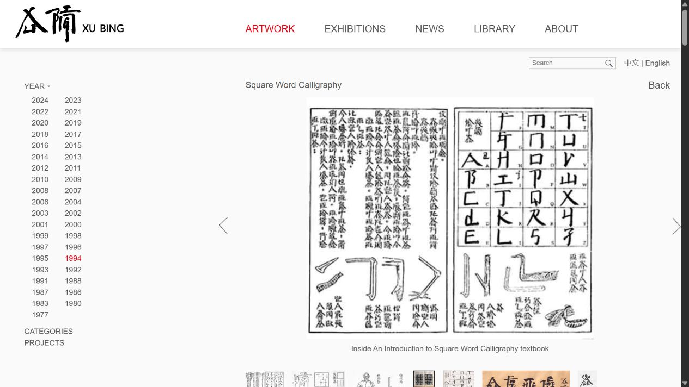

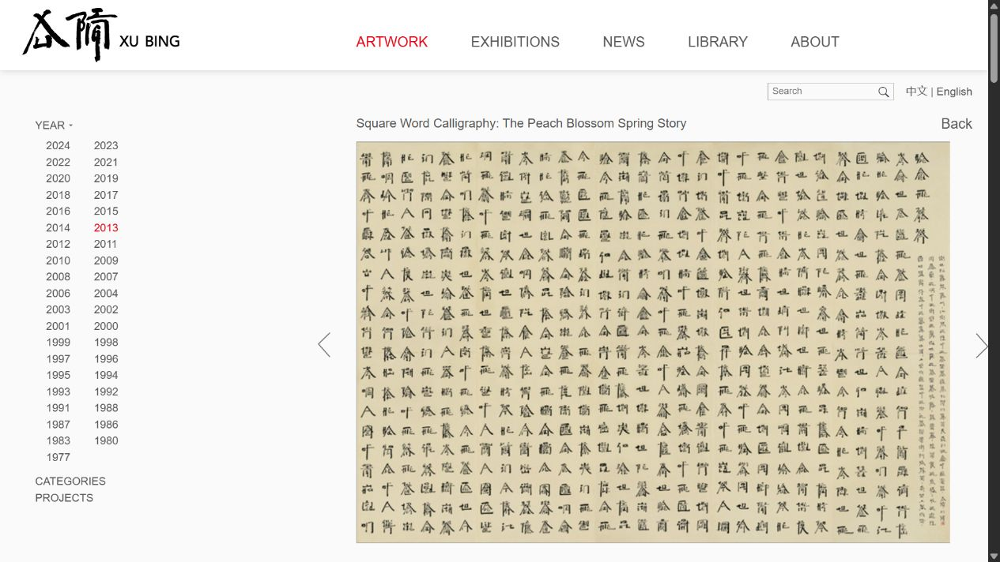

### C03 徐冰：文字写生 / The Suzhou Landscripts

来源：[艺术家文字写生项目页](https://xubing.com/en/work/details/231?type=project#231)；[阿什莫林博物馆展览介绍](https://jameelcentre.ashmolean.org/collection/6980/10293/morph/hide)；[馆方Landscripts专节](https://jameelcentre.ashmolean.org/collection/6980/10293/10374)。

**实际读取**：馆方专节和项目页说明；查看两张苏州文字写生的展场照片。图片足以判断四幅山水的整体组织，未能据此逐一识别画中细小文字。

**作品机制**：按馆方说明，水、木等文字成为画面构造单位，通过安排形成河流、树木等关系，继而构成山水。文字进入场景的生成方式。

**迁移判断**：本题值得研究八字怎样组成整体景象，以及字内外的疏密如何组织观看。不能只把山水画叠在普通字上，就声称完成了相同机制。

**核对修正**：艺术家年份页面包含多组作品，首次打开2013年页面时，实际先显示英文方块字《桃花源记》。已按画面标题修正截图命名，随后另行定位苏州文字写生。页面URL或检索标题不能单独证明看到了哪件作品。

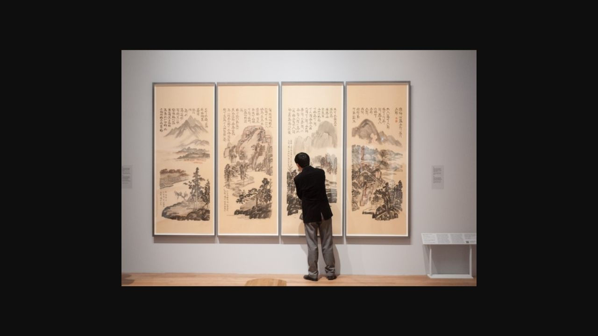

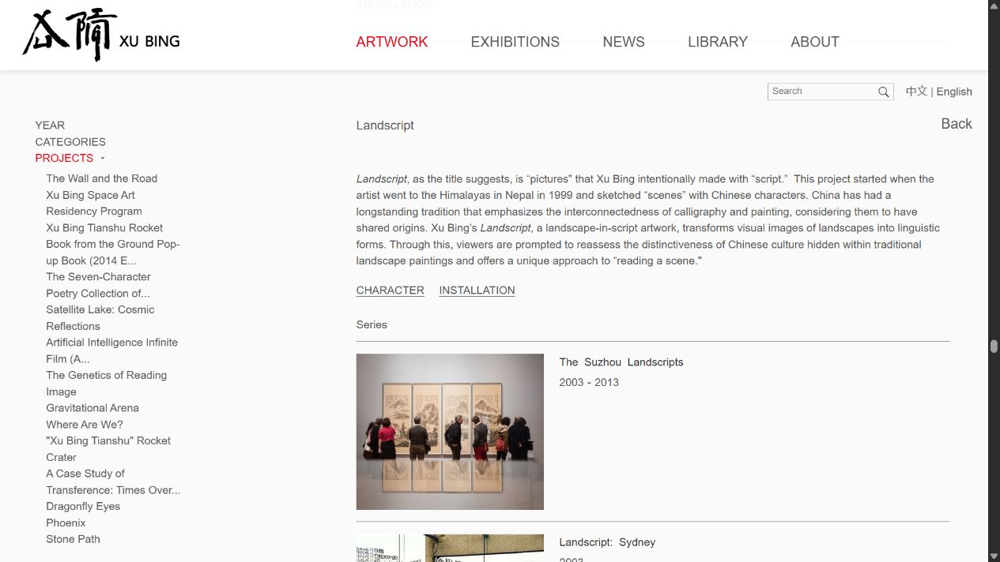

### C04 徐冰：《活字》系列的空间转化

来源：[摩根图书馆与博物馆2011年展览页](https://www.themorgan.org/exhibitions/xu-bing)；[UAP制作方：上海图书馆东馆项目](https://www.uapcompany.com/projects/xu-bing)。

**实际读取**：摩根展览页的检索可见正文，详情返回403；UAP项目说明和制作信息。此次没有完整观看视频，也没有保存这两处装置的图像。

**作品机制**：摩根的说明描述鸟字由地面释义进入空中并改变字形；UAP记录另一版本的空间制作。两处是不同版本，不能混用数量、材料或字形细节。

**迁移判断**：文字的状态和位置变化能够成为叙事。静态标题也可选择转化发生的关键瞬间，而非只展示一个已经定型的符号。

### C05 殷琳琳：Stories Hidden in Chinese Characters

来源：[D&AD创作者访谈](https://www.dandad.org/work/annual-2021/behind-the-work/how-yin-linlin-drew-on-ancient-paper-crafting-techniques-to-create-a-book-with-dual-meaning)。

**实际读取**：关于设计起点、折页、显露与隐藏、材料及尝试过程的访谈段落。没有实际翻阅该书，也未在本轮核对全部图片。

**作品机制**：折叠把古今字形的转换组织成阅读过程，内容与物理结构相互约束。

**迁移判断**：文化主题可以先转为一种体验，再转为造型。可研究标题的展开、断裂、剥离等过程，不能只借其黑金配色或古字外观。

### C06 范学超：《绞字造象》

来源：[中央美院美术馆工作坊与毕业作品介绍](https://www.cafamuseum.org/exhibit/newsdetail/2288)。

**实际读取**：作品介绍、材料、创作年代、导师资料；查看同一照片中两幅文字状态的对照。未观看完整动态视频。正文写明作品创作于2019年，页面顶端显示的当前日期不作为作品年份。

**作品机制**：从书法的图形拆解出发，将字的部件交给机械运动，改变后形成新的意象。

**迁移判断**：部件位置与关系可以真正重排，原字的一种状态与另一种状态互相解释。若只有随机打散、没有新的关系，重构仍可能停留在形式游戏。

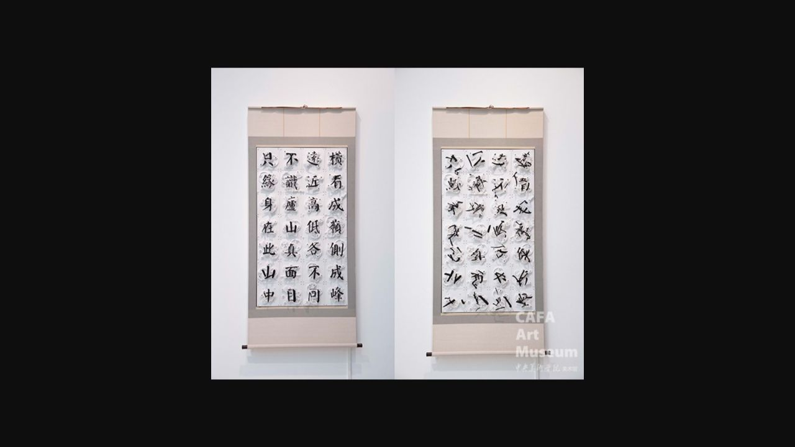

### C07 赵清：Character Generation

来源：[AGI作品记录](https://a-g-i.org/design/character-generation)。

**实际读取**：项目说明、作者与2022年项目信息。列有十张图片，但本轮未成功打开大图，所以不分析具体笔画成效。

**作品机制（依据作者说明）**：英文、中文读音字形、大小写字母及中阿数字之间作组合实验，建立不同系统的对应与生成规则。

**迁移判断**：值得学习的是持续产生变体的规则，而非一次性碰巧相似的外形。但需要看到实际图形，才能判断哪些组合可辨认、哪些只成立于说明。

### C08 故宫《自叙帖》赏析

来源：[故宫精选赏析](https://theme.npm.edu.tw/selection/Article.aspx?sNo=04001004)。

**实际读取**：馆方有关线条、运笔、轻重与字行呼应的说明；仅打开了一张低分辨率缩略图，该图主要为题跋相关部分，不能支持精细笔法分析。报告关于狂草组织的论点主要依据馆方说明。

**机制提炼**：可用疾徐、连断、轻重、上下左右的往复与字行呼应来分析运动组织。

**迁移判断**：本题需要探索结构与章法的狂放。粗笔、飞白或墨点的数量，不能单独决定气势。

## 二、五组前轮作品的复看

这些是前轮已访问小红书并保存的截图。本轮用本地图片重新查看，不计为新打开的帖子。账号是可见发布者，未另行证明全部原作归属。

| 复看对象 | 原帖 | 这次重新确认的机制 | 对上一轮设计的启示 |
| --- | --- | --- | --- |
| 宁木NIMU，“贪” | [原帖](https://www.xiaohongshu.com/explore/6a15e7ec0000000006036f4c) | 中部延伸、抓取方向与围合空间共同承载情绪 | 关注动作与对象之间的关系，不能只提取一只手 |
| Sunzw，“灯笼” | [原帖](https://www.xiaohongshu.com/explore/69f83c22000000001a036257) | 两字压进同一圆形整体，配件帮助识别物象 | 可以突破单字各占一格；同时承认识别依赖主题与配件 |
| 哦哈纳，金文×山海经 | [原帖](https://www.xiaohongshu.com/explore/694bb094000000001f00e017) | 身体、角、尾与文字部件共同承担轮廓 | 要研究对象的身体结构如何影响整个字，不能只加装饰 |
| 小舞设不出来，昭陵六骏 | [原帖](https://www.xiaohongshu.com/explore/6947feb2000000001e03866b) | 大字形、裂痕、姿态与小元素形成系列 | 统一可以来自同一叙事规则，各图不必一样整齐 |
| 乡澜文旅，“山” | [原帖](https://www.xiaohongshu.com/explore/6a7edeab000000000503159c) | 山景叠入大字，字与景有联系，但仍能明显区分 | 作为反例提醒：不能因为字与图同题，就判为共享结构 |

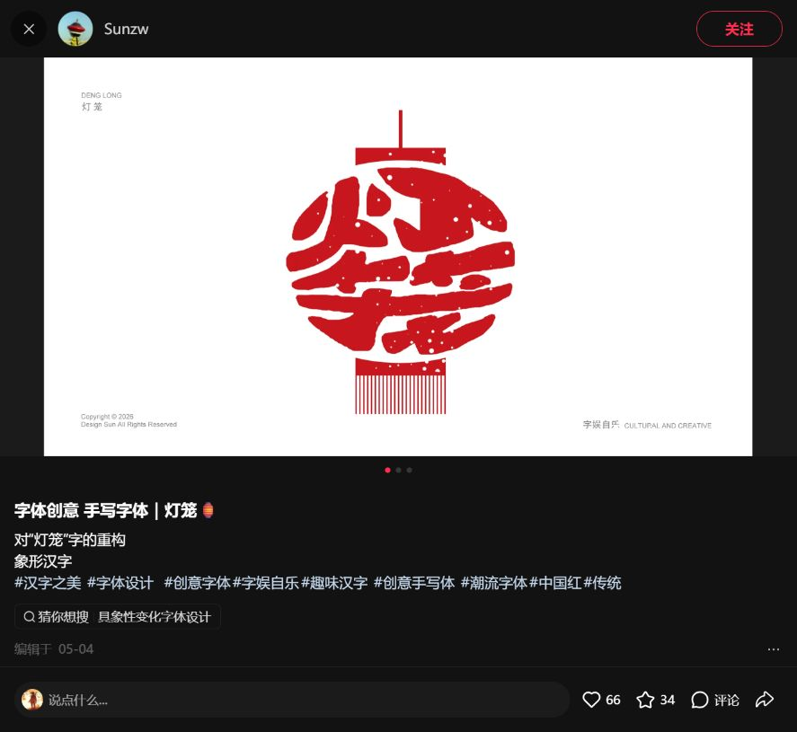

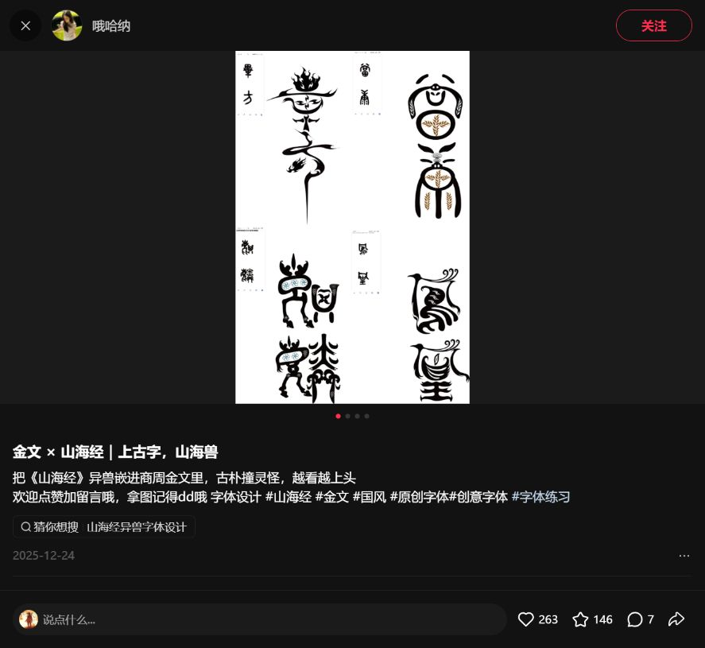

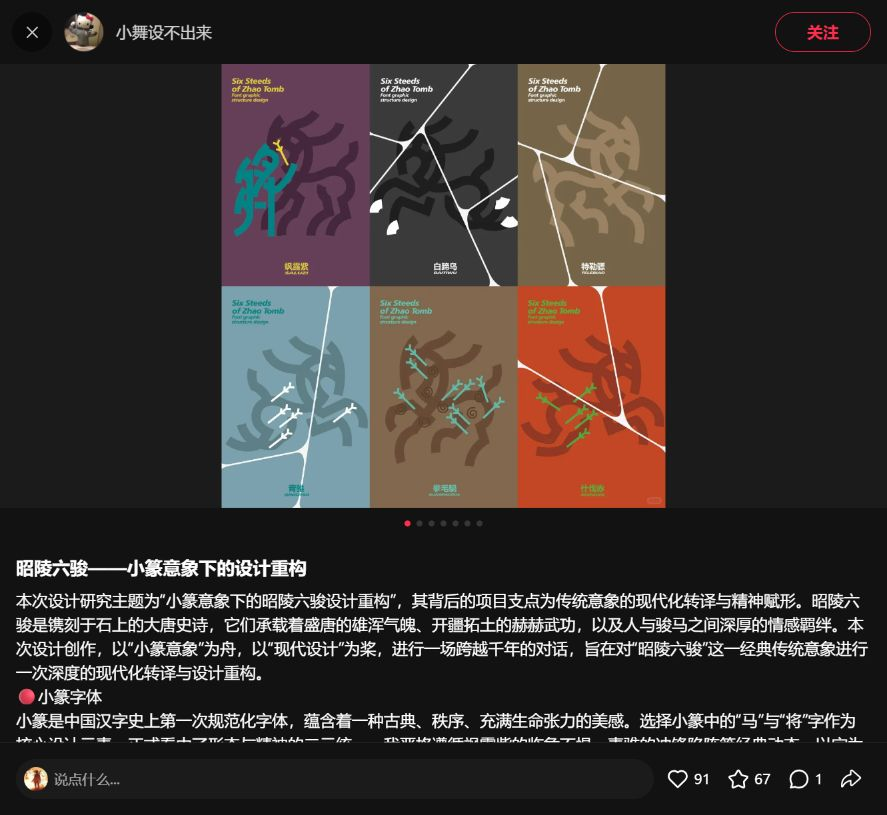

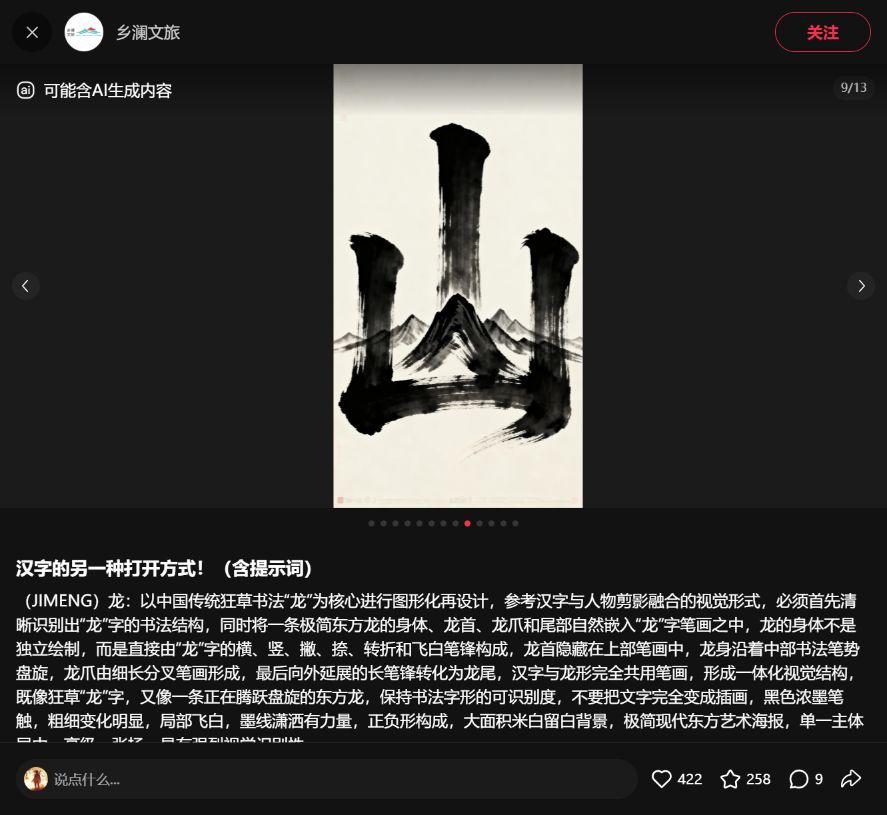

## 三、旁证：不混入汉字主样本

### 何见平 Coexistence（2015）

[工作室原作页](https://www.hesign.com/works/coexistence)。已读取项目资料并查看原图。画面是拉丁字母与密集斜向线条的叠置、变形关系，不能列为汉字构形案例。

可作为关系表达的旁证：共存可以由两种视觉秩序相互作用来表现，不必须依赖双人图标。对文字可读性影响很大，不能直接套用活动标题。

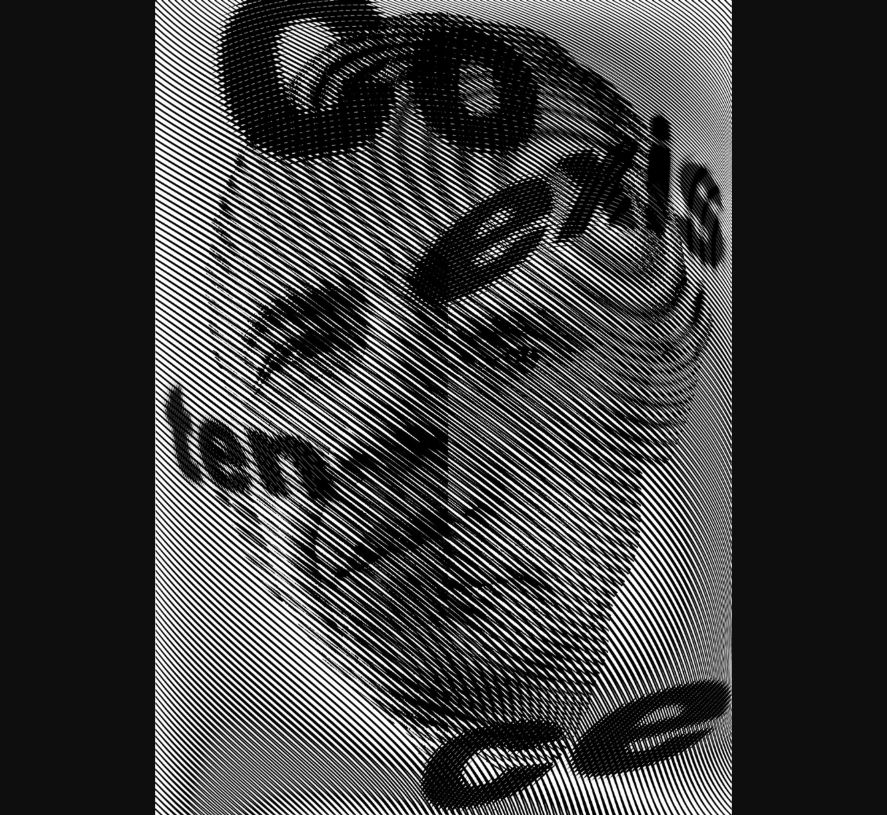

### 何见平 Bilder-Schrift（2005）

[工作室原作页](https://www.hesign.com/works/bilder-schrift)。已查看画面：山景雾气与竖向拉丁文字互相遮显。它属于字图空间关系的旁证，不是汉字笔画重构。

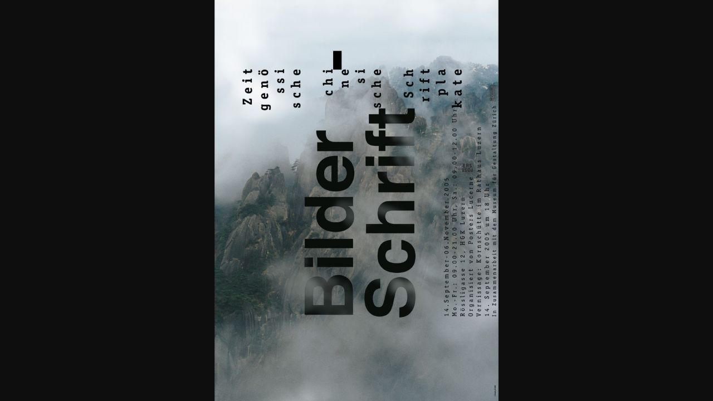

### 汉仪黄科榜书

[字体厂商产品页](https://www.hanyi.com.cn/productdetail?id=7228&type=0)。检索返回的官方文字提到错位、大小变化及紧凑组合；当前详情页的设计介绍为动态内容，本轮未完整核对展示图。只用作标题字组编排的线索，不用其营销描述证明创新成效。

## 四、文化与理论资料

| 来源 | 实际读取范围 | 在本项目的用途 |
| --- | --- | --- |
| [国家图书馆：汉字的构成](https://memory.nlc.cn/topic/resource/62) | 六书及形音义的说明 | 区分文字学事实与现代设计联想 |
| [陈楠：古老汉字如何焕发新生](https://www.ad.tsinghua.edu.cn/info/1205/28179.htm) | 访谈及部分作品图 | 区分字库设计、图形创意与文化转译 |
| [陈楠：让传统的成为时尚的](https://www.tsinghua.edu.cn/info/1182/52149.htm) | 检索返回正文及页面可见段落 | 传统内容进入当代设计的思路；未核对文中所有案例原图 |
| [陈楠：甲骨文字库和表情包访谈](https://www.ad.tsinghua.edu.cn/info/1205/28707.htm) | 检索返回正文及页面部分段落 | 观察古文字进入当代媒介的路径，不宣称读过其全部研究 |
| [湘潭大学：校训释义](https://www.xtu.edu.cn/xdgk/whbs/xx.htm) | 有关“日新”的相关释义 | 扩大“新”从行业图标到长期更新的解释空间，不作为长江商学院官方主题释义 |

## 五、没有当作完成研究的材料

- M+靳埭强页面：读到作者资料及藏品数量，没有打开具体作品，不据此分析其某张海报。
- 香港艺术馆《字由人》展览册：读到检索摘录，PDF详情访问失败；不声称阅读整册。
- 香港文化博物馆“争鸣年代”PDF：详情请求失败，不对其作品图作分析。
- UNESCO中国书法页面：遇到验证界面，未进行验证，不引用其未读正文。
- 何见平 Collaboration：读到标题、年份、客户与尺寸，未核对图像，不推断其视觉机制。
- D&AD Great Beauty of Chinese Characters：读到书籍介绍与项目资料，未看全书，不将内容简介当成字形设计分析。
- 故宫吴昌硕、央美其他相关检索：用于发现后续线索，本轮没有据此形成完整作品案例。

## 六、截图说明与实际范围

本目录保存九张本轮浏览器研究截图、五张前轮复看截图，以及一张被否定的设计对照图。截图数不等于独立案例数。

- 英文方块字两张、苏州文字写生两张，是同一系列的不同画面，不能重复计为多个独立方法。
- 自叙帖缩略图不能作为精细草书视觉分析的证据。
- “苏州文字写生展场”是观众与作品的现场照片，不是字形细节图。
- 复看截图中的历史字源、文物配色对应、作者归属等，未得到独立核验的仍保持未核验。
- 原稿已经在本对话中重新查看；临时附件原路径随后不可用，本目录没有重新生成或冒充原图的文件。
- 研究截图用于本项目分析，作品署名与出处按上文保留。

