# 汉字重构与意象化：基于小红书与抖音的案例研究

研究日期：2026年10月21日。研究方式：在 Codex 内置浏览器实际访问两站，沿用“汉字重构”“汉字创意设计”的搜索结果，进一步打开与意象化、字图同构、古文字、负空间、合字、动态及空间应用相关的内容。本报告的判断是设计观察与归纳，不是经过实验验证的行业定律。

## 先说研究所得

汉字创意可以从三个问题进入：观众要认出什么字、感受到什么含义、在什么场景里使用。笔画、图形、材质和运动都可以改变，但改变需要服务于这三个问题。许多作品的创意不在于增加了多少图案，而在于找到一处让“字的结构”与“物的结构”同时成立的关系。

重构与意象化可以分开理解：重构改变文字元素的组织方式；意象化让形态唤起物象、动作、情绪或文化联想。几何切割可能只有形式变化，抓取的手势可能已经产生语义表达；两者可以结合，却不能仅凭“变形”二字视为同一种设计。

## 查阅的深度与边界

本轮共实际打开21条内容：小红书12篇、抖音9条。其中抖音D04实际为拉丁字母案例，作为旁证排除，留下20条汉字相关主样本。这一统计表示打开并核对了具体内容，不表示21条都完整看完；D08为对前轮仅阅读发布文字的材料补做画面核对。另有前轮3例用于交叉比较。

- 小红书新打开的十二篇笔记：查看了可见正文和作品画面；多数以首张总览或首张主图为主，没有把未翻阅的内页算作已读。其中“汉字的另一种打开方式”连续查看并保存前九张图，阅读了其“龙”“鱼”的提示词。
- 抖音按作品查看标题、发布账号、可见字幕、具体视频画面和页面作品 ID。截图是分时观察的关键画面，不等于逐字逐句看完全部视频或听完全部音轨。
- 原创作者、发布账号、合集整理者并不总是同一个主体。报告中的账号表示实际访问的发布者，未确认原作归属的内容不作为作者生平或设计史依据。
- 古文字的字源、字体名称、历史年代以及城市文化符号，如仅见于帖文或评论，均不视为已独立考证。评论用于发现问题，不能替代事实核验。
- 另参考上一轮已经核对的“云”字六版、剪纸字体和“风”字风铃，单独标为前轮材料。

## 一、从案例中归纳的八类方法

| 方法 | 具体改变什么 | 本次看到的案例 | 更适合的用途 | 主要取舍 |
|---|---|---|---|---|
| 局部笔画替换 | 将一处笔画变成语义相关的图形 | 衣食住行；实物门图像嵌入单字 | 标志、主题字、短标题 | 图形尺度、粗细和方向须融入其余笔画 |
| 整体轮廓同构 | 让整个字或词服从物体轮廓 | 鸟；灯笼 | 主视觉、节庆图形、文创 | 物象越强，文字结构越容易被牺牲 |
| 字内负空间 | 让字内空白参与造型 | MA°Design 的负空间示例 | 标志、单色印刷、成套字 | 缩小时空白是否还能看见 |
| 部件拆解与合字 | 共享、嵌套、压缩多个文字部件 | 合体字；多字组合为画 | 印章感图形、祝福文创、展览 | 阅读路径和解码负担 |
| 笔画性格重构 | 改变曲率、端点、粗细、断连与重心 | 曲线字体合集；前轮云字六版 | 品牌标准字、海报标题 | 不能只统一表面效果而忽略字内空间 |
| 情绪与动作隐喻 | 用抓取、伸展、挤压等关系表现含义 | 宁木 NIMU 的“贪” | 文化海报、书籍、情绪主题 | 联想是否足够明确，是否必须靠说明才能理解 |
| 古文字与文化转译 | 从古字形或文化对象提取构成规则 | 金文×山海经；昭陵六骏 | 文博、展览、文化系列 | 形态依据与文化对应是否准确 |
| 时间、光影与实体结构 | 让运动、投影、材料或功能完成识别 | 鱼字短片；聽字投影；前轮风字风铃 | 动态传播、装置、产品 | 需要指定观看条件，单帧效果不能证明可落地 |

这些是本次研究的分类工具，不是互斥的官方分类。例如“灯笼”同时包含合字和整体轮廓同构，“昭陵六骏”同时包含古文字转译、姿态与系列视觉。

## 二、最值得带回后续创作的七项判断

### 1. 先决定阅读顺序，再决定变形幅度

“衣食住行”主要保留原字结构，观众可以先读字，再发现衣架、碗、房屋、鞋底。“灯笼”和多字人物画更依赖先认轮廓，再寻找文字。两种顺序都可以成立。需要快速传达名称的标志应控制解码负担；需要停留、发现和讨论的海报可以容纳更复杂的关系。

### 2. 更有价值的是共享结构

衣架的横向轮廓与“衣”的上部结构、鞋底与“行”的局部笔画、灯笼轮廓与文字压缩，都提供了具体的连接点。评估时可以问：去掉独立插画后，字的笔画本身是否仍在表达那个对象？如果表达主要依靠旁边的图像、颜色或装饰，那是图文组合，也可以好看，但不宜误判为已经实现笔画同构。

### 3. 意象化还包括动作、情绪和关系

“贪”的抓取手势把抽象心理变成可见动作。这里值得学的是笔画之间“伸向、抓取、包围”的关系。面对抽象主题，可以先列出动作词，如靠近、分离、拉扯、托举、坠落、扩散，再寻找与字结构相容的动作；不必每个主题都找一个实物图案替代。

### 4. 减法与留白需要独立检查

抖音教程展示了笔画删减，另有负空间处理。它们说明“创意”不只来自增加元素。粗细相同的字，也可能因为内部空间、连接数量和字面大小不同而显得不协调。实际处理成套字时，需要同时比较黑色面积、空白通道、视觉重心和细节密度，不能机械地把所有字的圆角或线宽设成相同数值便结束。D07对留白的讲解可作入门提示，但“留白越大就越轻盈”等说法不能脱离字面、笔画与构成条件单独使用。

### 5. 文化内容需要成为设计约束

城市地标字的评论区提出了符号代表性、地域文化对应以及英文拼写的质疑。这些质疑本次未逐项考证，但足以提醒设计前要核对对象。“昭陵六骏”则提供了一种值得比较的思路：由主题同时约束字形、姿态、配色和裂痕，而不是先做一套通用字体，再加入古风装饰。具体史料依据仍需另外核实。

### 6. 一套字需要一套可复述的规则

“同一种颜色”“同一种毛笔质感”只能建立部分一致性。更有用的规则包括：哪些位置可替换、哪些关键结构不可动、端点怎样收、曲线怎样转、负空间如何保持、图形细节保留到什么程度。能从单个案例扩展到下一字，才开始具备系列方法。D08的贵州印象还提供了另一种一致性：不同字采用不同意象，但以固定的信息层级、卡片版式与处理方式把它们组织成系列。

### 7. AI提示词中的目标，不等于成图已实现

乡澜文旅的提示词明确要求共用笔画与双重识别。但实际前九张图中，鱼、舞、鸟等融合程度各有不同；山的例子也保留了明显的“字加景物”关系。“要求了什么”与“做到了什么”需要分开评估。AI可用于探索轮廓、笔触和意象；字形识别、笔画关系、文化准确性与系列一致性仍要逐项复核。

## 三、十二篇小红书案例卡

### X01 衣食住行｜字体创意

发布账号：是無山居人。[原帖](https://www.xiaohongshu.com/explore/699eb96100000000220203e2)

**实际看到：**五图笔记的第一张四字总览及正文。衣架、碗、房屋与鞋底分别融入对应字形，主体统一为黑色书写笔触。

**提炼：**识别骨架保持较完整，在少数关键位置设置图形替换点，能兼顾读字与发现细节。需要控制替换图形和其他笔画的重量。

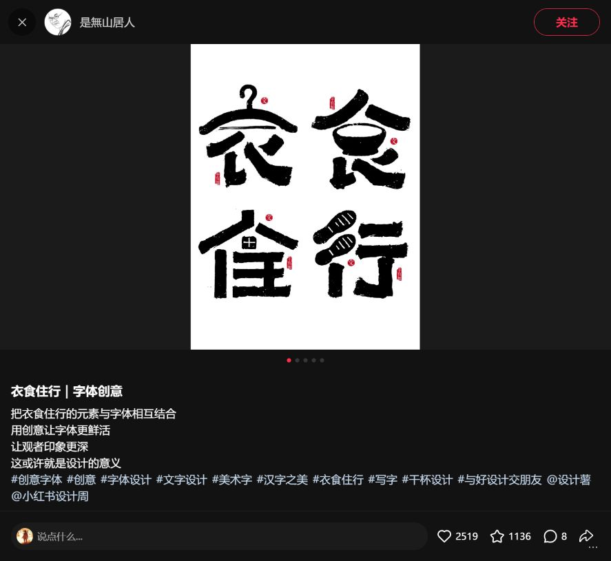

### X02 当城市地名与地标融为一体

发布账号：D9設計。[原帖](https://www.xiaohongshu.com/explore/6901ff1900000000040231a3)

**实际看到：**首图把福州文字压缩为塔状轮廓，下方以建筑照片对照；阅读了介绍多个城市的正文及部分评论，未把正文提到的全部内页算作已看。

**提炼：**建筑的竖向轮廓可成为字形的总骨架。但地域对应、代表性、名称准确性都影响表达，不能仅靠形式融合判断成功。

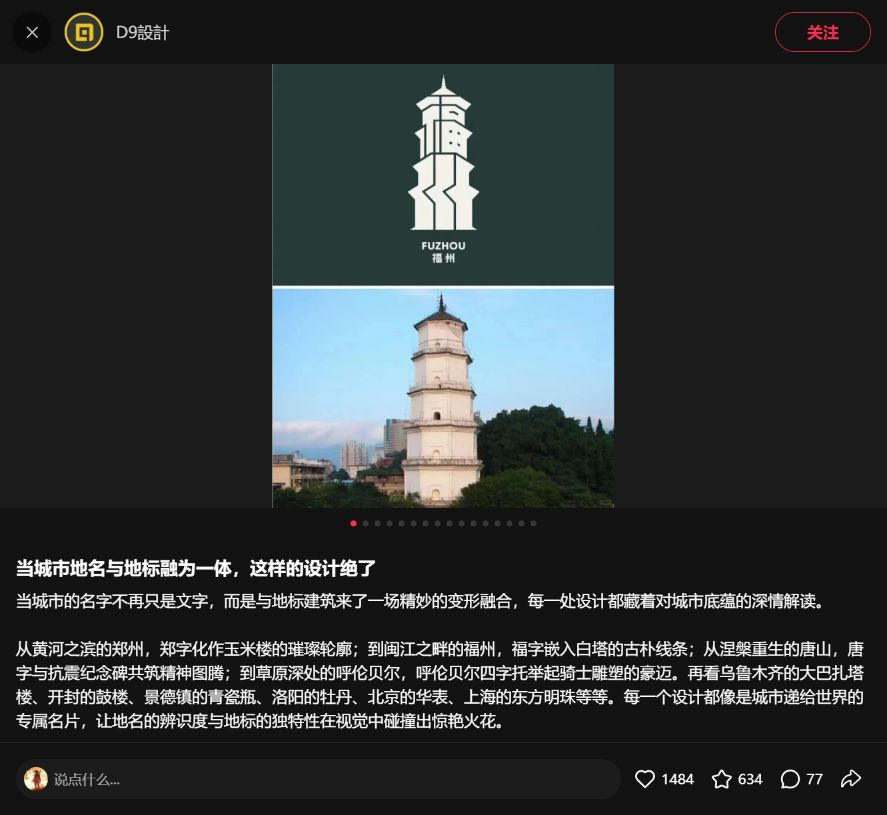

### X03 象形文字实验丨鸟

发布账号：苟博+成都火麒麟包装设计。[原帖](https://www.xiaohongshu.com/explore/69fe8fce000000003502d287)

**实际看到：**首张海报及正文。以统一线条组成鸟形字，圆目、喙、尾和爪参与轮廓，内部还有更小的鸟形。

**提炼：**整体同构依靠轮廓、方向与关键特征。内部再嵌一只鸟增加层次，但小尺寸时也可能成为可以删减的细节。

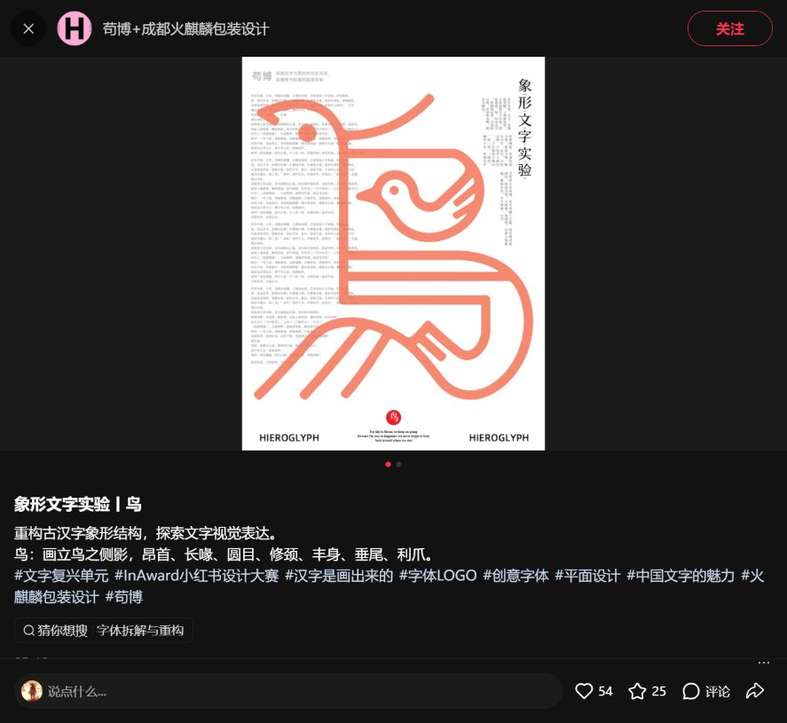

### X04 金文×山海经｜上古字，山海兽

发布账号：哦哈纳。[原帖](https://www.xiaohongshu.com/explore/694bb094000000001f00e017)

**实际看到：**首张四组作品总览及正文；兽首、角、肢体和尾部进入字形。

**提炼：**可学习把文化对象的特征转成文字部件。笔画源流未独立核验，不能用该帖证明某个设计就是历史字形。

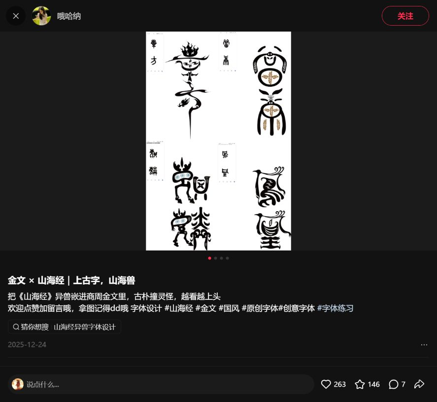

### X05 昭陵六骏——小篆意象下的设计重构

发布账号：小舞设不出来。[原帖](https://www.xiaohongshu.com/explore/6947feb2000000001e03866b)

**实际看到：**首张六幅海报总览和较完整的设计说明。说明将“马”“将”字、马的动态、配色及裂痕联系起来；画面以大字形、断裂线及高对比小元素建立系列。

**提炼：**同一主题可以产生多层约束，系列感来自结构与关系。配色对应史料的说法仅作为作者阐述记录。

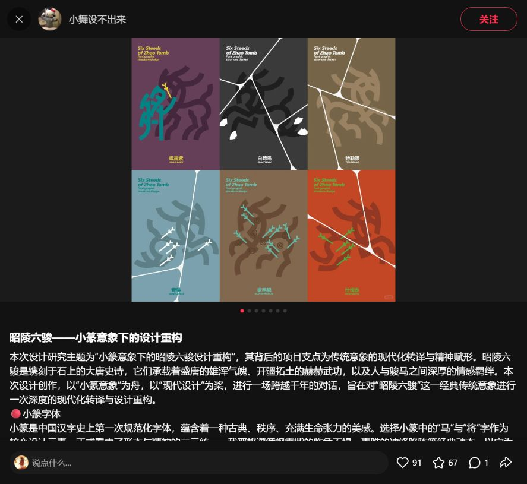

### X06 小众高级感字体合集｜自由解构、曲线重构汉字

发布账号：Lyra。[原帖](https://www.xiaohongshu.com/explore/6a3765c80000000017028299)

**实际看到：**首张多组字样及长正文。内容归纳圆润块面、流线与几何拆解等方法。未确认合集内各字样的原作者。

**提炼：**这些可以用作形式变量清单；“高级感”“各种场景都适配”属于发布者评价，不能替代具体应用测试。

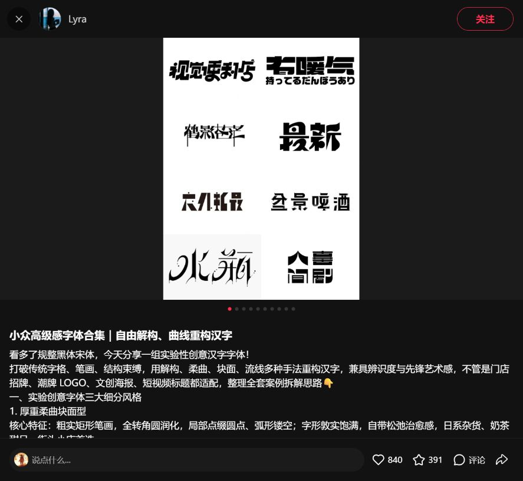

### X07 多字变形组合为画

发布账号：老妖的胃和远方。[原帖](https://www.xiaohongshu.com/explore/699c560c0000000009038867)

**实际看到：**首张拍摄的文字画及短说明；部件纵向组合成侧面人物与手的形态。发布者表示是在中国文字博物馆看到，原作归属本次未确认。

**提炼：**局部字形可以服从更大的轮廓；适合“先认画，再找字”的观看体验，不宜强行当作快速阅读的标准字。

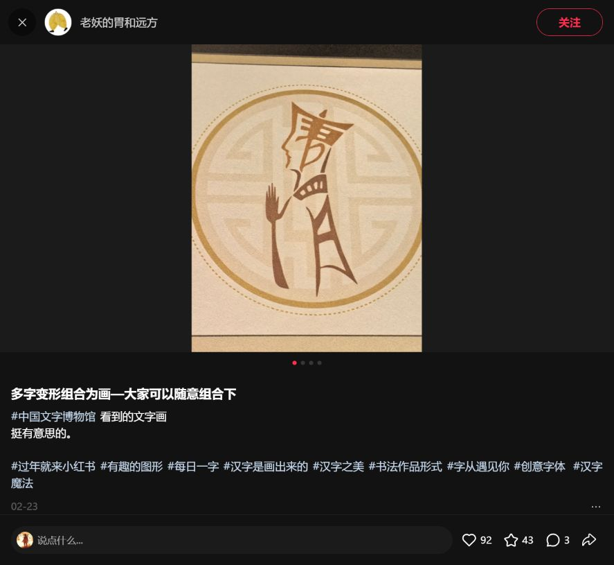

### X08 当情绪变成图形

发布账号：宁木 NIMU。[原帖](https://www.xiaohongshu.com/explore/6a15e7ec0000000006036f4c)

**实际看到：**首图“贪”及正文。中部笔画延伸为向下抓取的手；作者说明书法笔触结合AI辅助。

**提炼：**以动作承载抽象含义，笔画方向比额外装饰更关键。不能据此推断整组未看的其他字也同样成立。

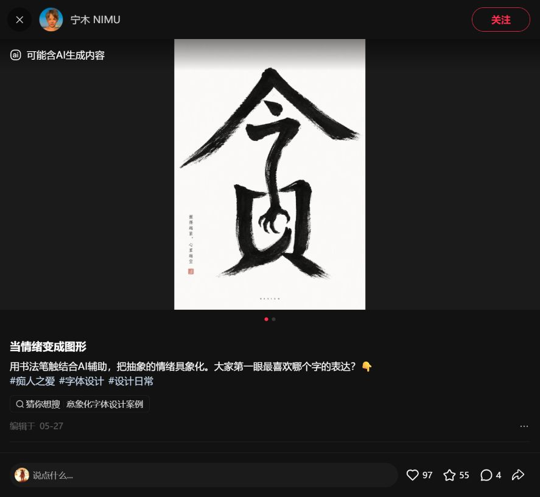

### X09 字体创意 手写字体｜灯笼

发布账号：Sunzw。[原帖](https://www.xiaohongshu.com/explore/69f83c22000000001a036257)

**实际看到：**首图及正文。两字压缩进圆形灯笼身体，配以挂杆、流苏与红色。

**提炼：**多个字可以共享一个外轮廓；挂杆与流苏承担物象识别，红色进一步强化联想。需要分别测试没有颜色和没有配件时的识别情况。

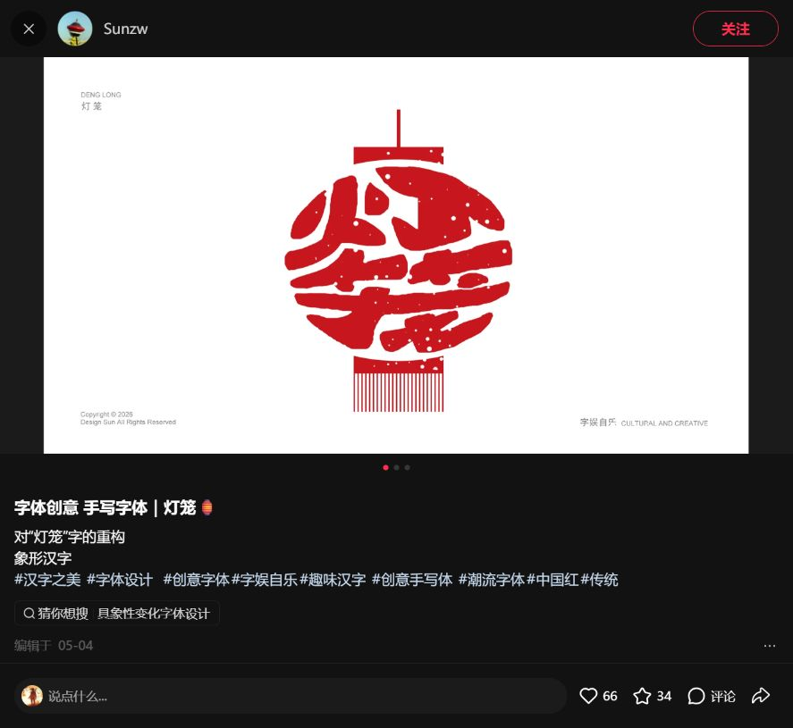

### X10 这些“合体字”绝了！快来挑战

发布账号：羊先生。[原帖](https://www.xiaohongshu.com/explore/6a3c08730000000006032ecf)

**实际看到：**首张十二项合字/字样合集及正文。使用共享、嵌套和部件压缩，将词句组合成紧凑块面。原作出处及帖内民俗、字源说法未逐项验证。

**提炼：**合字的可读性常依赖熟悉的词句和附注。可以学习构成关系，不能把附注当成字形准确性的保证。

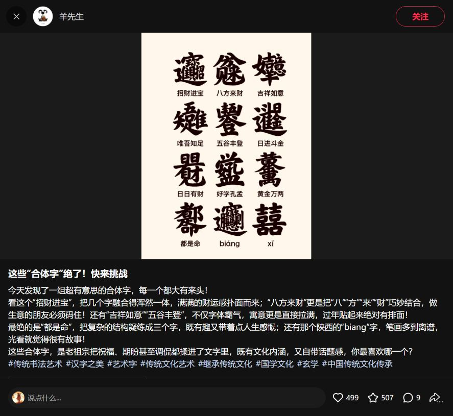

### X11 汉字的另一种打开方式！（含提示词）

发布账号：乡澜文旅。[原帖](https://www.xiaohongshu.com/explore/6a7edeab000000000503159c)

**实际看到：**十三图笔记中的前九张：鱼、舞、龙形、琴、桥、花、舟、鸟、山等意象，及正文的龙、鱼提示词。第十张翻页时连接超时，不计入已读。

**提炼：**提示词把目标拆到具体笔画和身体部位，值得学习其约束方式。但实际输出有真正共享形态与插画叠加的区别，应逐张判断。当前文件名带“立体”的旧命名不代表该组主要方法；实际为书法与物象融合。

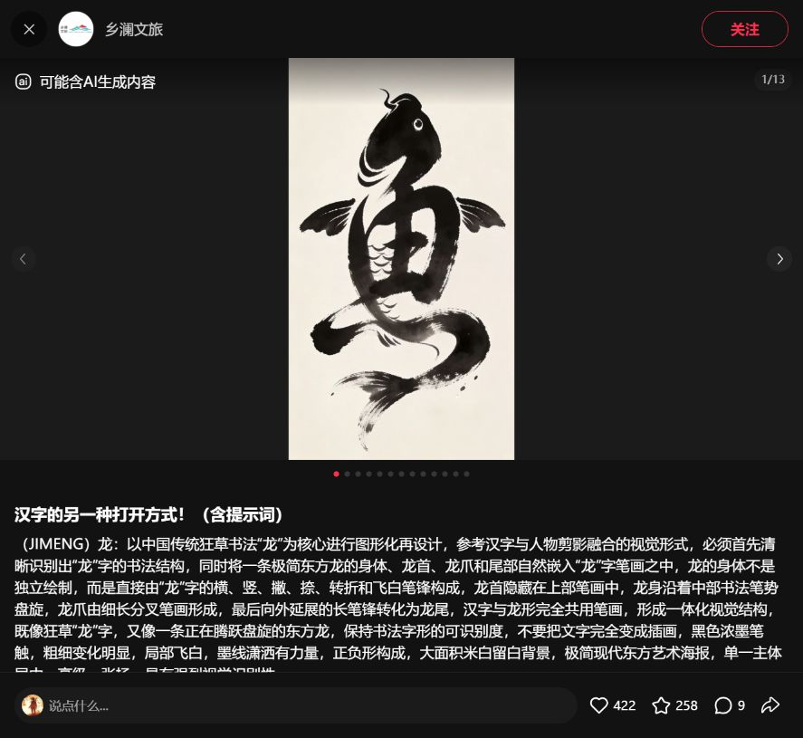

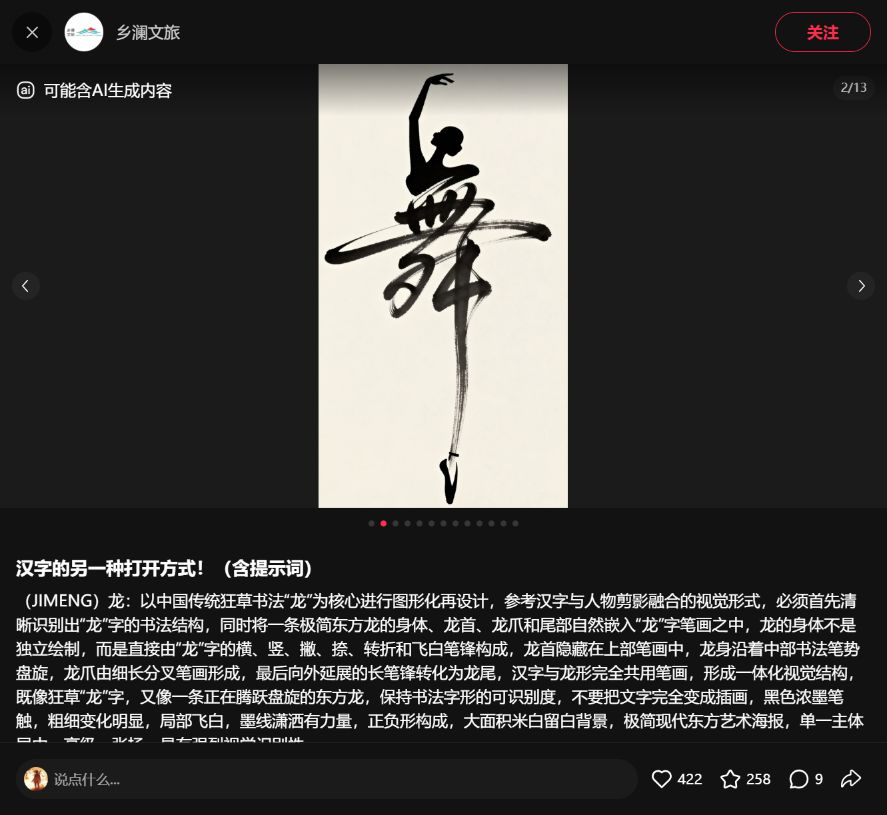

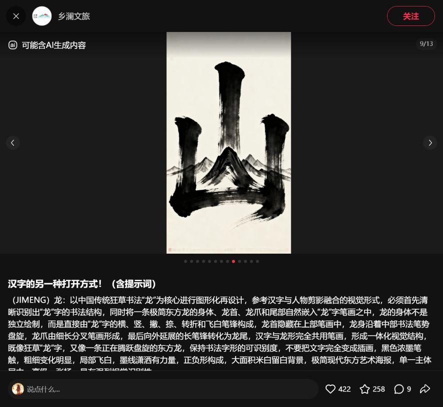

### X12 汉字拆出艺术感！文化空间这么做真是绝了

发布账号：蓝调文化墙。[原帖](https://www.xiaohongshu.com/explore/6983297f000000000a03df0b)

**实际看到：**首图悬吊的分散笔画在地面形成“聽”字投影，以及正文提到的悬浮字与桥字装置。未核实是否为实装照片、效果图或生成图，未看到工程细节。

**提炼：**识别可以转移到投影平面；空间方案需要把灯位、视角、投射面和观看路径一并设计。不能用一张图断言装置已可制造。

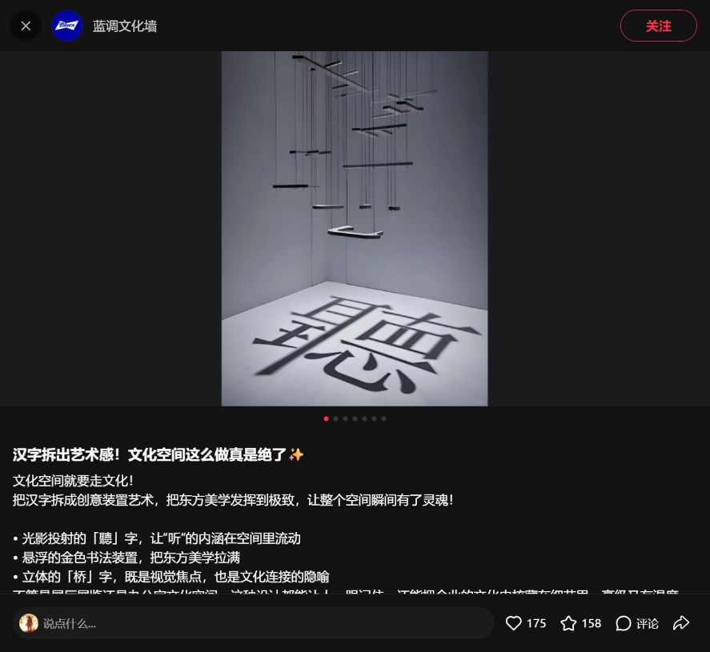

## 四、八条汉字相关抖音材料与一条旁证

| 编号 | 发布账号与内容 | 具体看到了什么 | 能支持的观察 |
|---|---|---|---|
| D01 | 北也设计《就给一个字？怎么设计更有创意？》 | 约00:34，实物门图像嵌入单字；字幕提到依据文字内涵改变笔画 | 局部图像替换，实物质感与其余笔画的协调 |
| D02 | 景怡LOGO设计《字体设计的8个小套路！》 | 约00:23“笔画删减”；约00:59“空间立体” | 减法与透视属于两种形式变化；本次未逐项看完八种方法 |
| D03 | MA°Design《字形中融入图形元素》 | 约00:36字幕讲字的负空间；约01:06对比装饰字与简化字 | 负空间可以参与构形；细节密度需要取舍 |
| D05 | 博物汉字《原来汉字动起来这么可爱》 | 约00:02鱼群中的古文字形；约00:06列出字形对照 | 用时间变化连接字与物；历史标注尚未独立考证 |
| D06 | 字体设计-刘兵克《字体图形化，居然这么有趣！》 | 约00:36古文字材料；约01:59鸟虫形态字；约05:53图标叙事；约06:49标志与动态/材质字示例 | 观察范围跨越长视频的多个阶段，但不是完整逐字听写；图形化涉及装饰、结构、图标叙事及材质等不同层次 |
| D07 | 设计师黑屿《了解字体负形，做成套字》 | 阅读较完整的发布说明；约00:33画面同时列出FedEx、汉字与SPACE的负形示例 | 字内空白也是构成对象；外文字母为对照，不能把不同文字系统机械套用 |
| D08 | 品牌设计视觉《贵州印象文创字体海报设计》 | 九字总览；下一页“镇”“书”细节；正文提及石昌鸿及周边延展 | 图形对象可各不相同，以共同版式建立系列；没有看到周边实物页，因此不宣称验证了文创量产应用 |
| D09 | 子牧说丨且曼学院《一看就会的文字小设计》 | 约00:55“牧记烤肉”的横排分隔；另一次循环约00:06“设计”的竖排与中间小字 | 这是排版变化的对照例，不等同于字形重构；字距、方向及小元素位置也可以产生视觉变化 |

作品链接：

- [D01 单字创意](https://www.douyin.com/video/7627054856016022827)
- [D02 字体设计方法](https://www.douyin.com/video/6968412670466870568)
- [D03 字形与图形](https://www.douyin.com/video/6996140351425629454)
- [D05 鱼字动态](https://www.douyin.com/video/7612967632995650826)
- [D06 字体图形化](https://www.douyin.com/video/7669759120426395633)
- [D07 成套字与负形](https://www.douyin.com/video/7647105723562804325)
- [D08 贵州印象](https://www.douyin.com/video/7073321789857795342)
- [D09 文字排版小设计](https://www.douyin.com/video/7158794383322647845)

旁证D04：玉文設計丨品牌LOGO的“字图笔画同构”视频实际展示拉丁字母F，已打开但不计入汉字主样本。[来源](https://www.douyin.com/video/7696361029089680463)

### 抖音代表画面留档

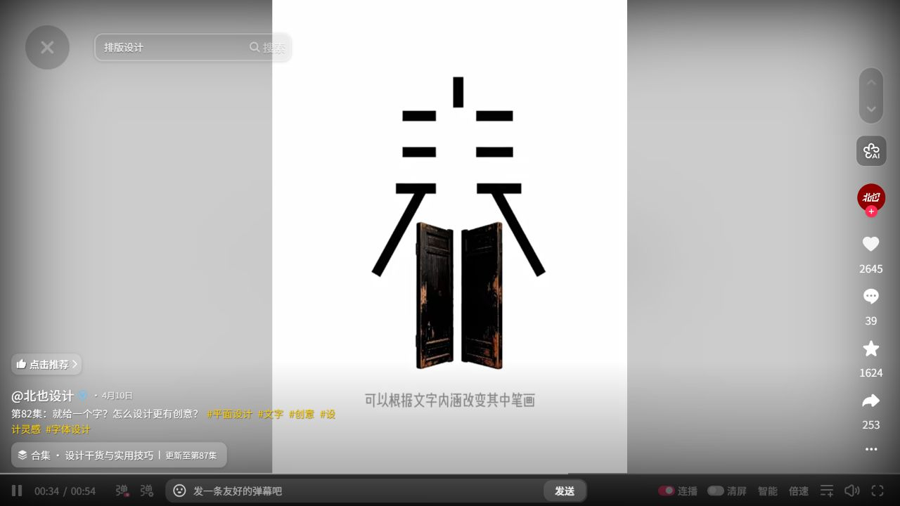

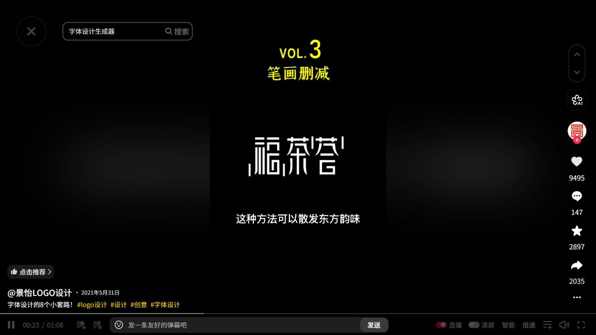

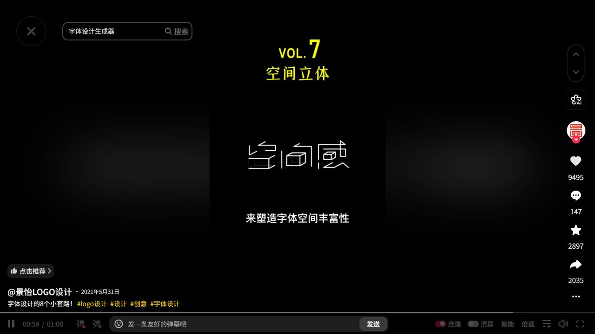

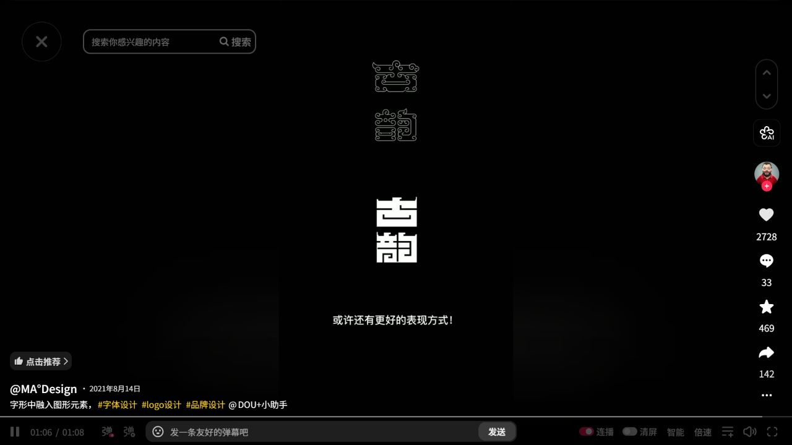

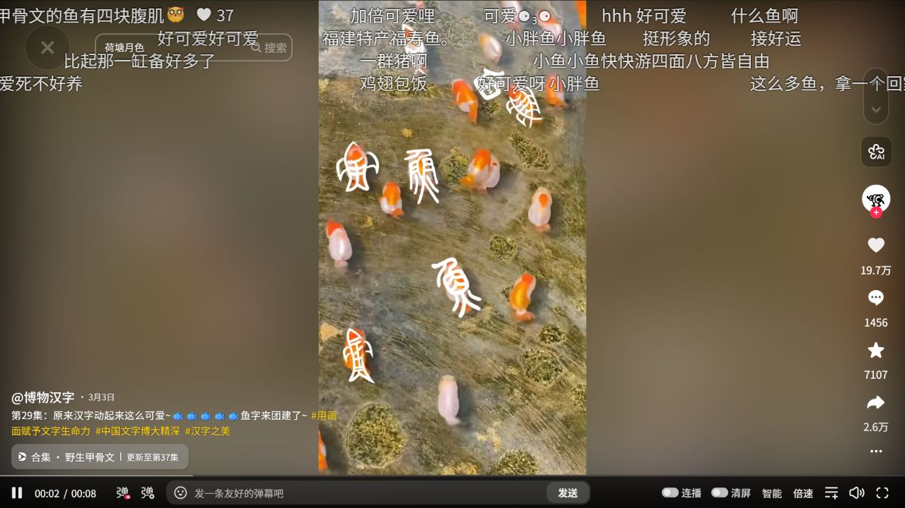

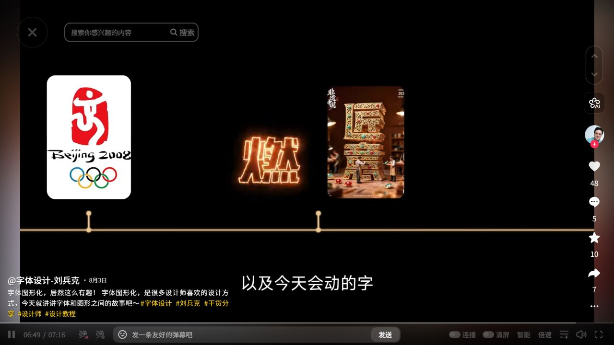

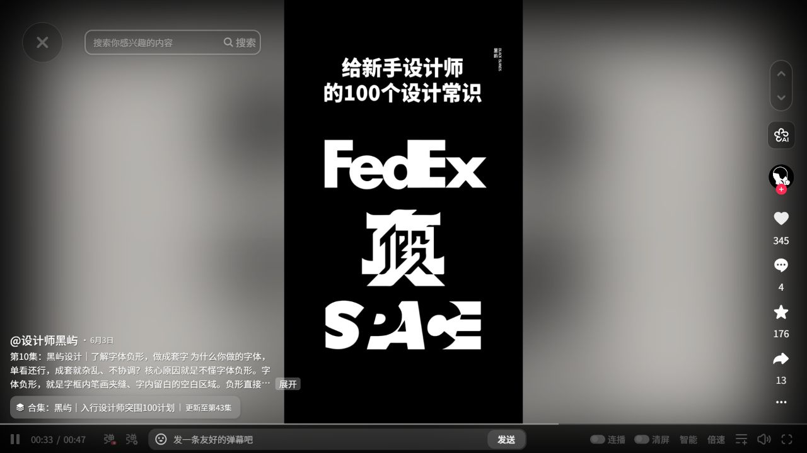

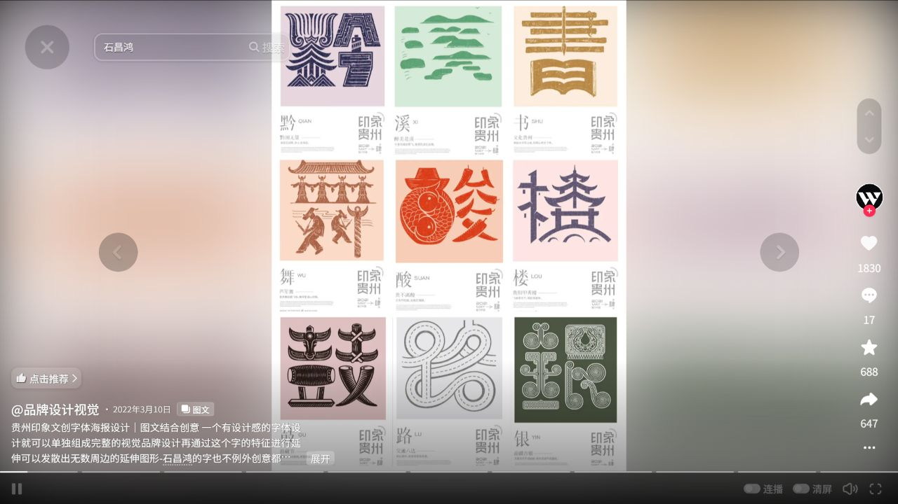

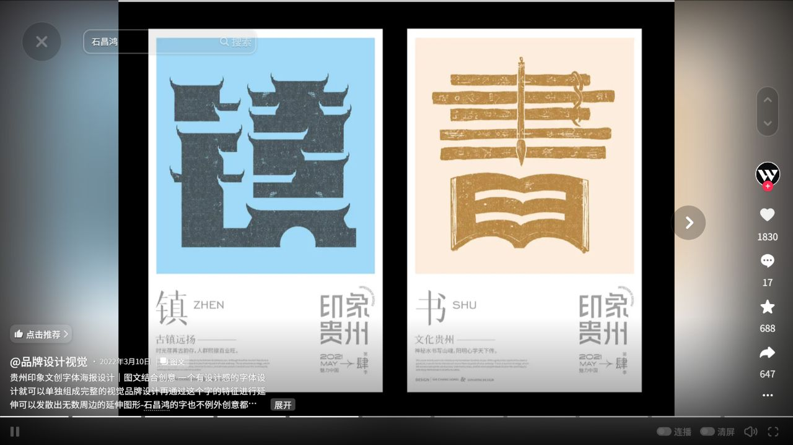

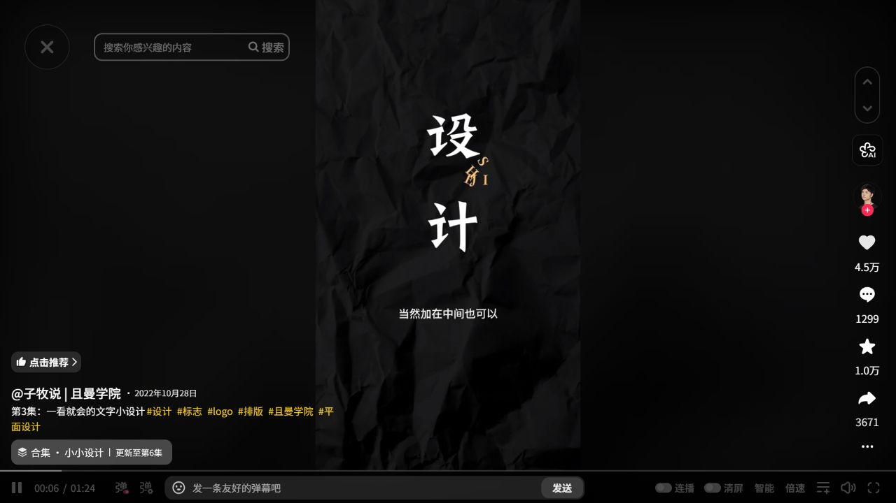

### 作为对照，需要分开的三件事

1. **排版设计**改变字与字、字与辅助元素之间的关系；不一定改变字本身，D09即属此类。
2. **字形重构**改变笔画或部件的组织方式；可以有语义，也可以只是几何、空间或性格探索。
3. **意象化**让形态、动作、材质或文化线索参与含义表达；可以发生在重构中，也可以依靠运动与环境完成。

因此，“图形很多”“字被拆开”“字体很古风”“提示词很长”都不能单独证明方案表达成功。应回到具体作品和使用场景检查。

## 五、把研究转成可执行的设计流程

1. **说明用途。** 写清楚是名称识别、文化叙事、情绪表达、动画还是实体产品；不要先默认所有方向都要兼顾。
2. **列出含义和动作。** 除了物件名，再写状态、动作、地域和材料联想，避免所有字都只做实物替换。
3. **画识别骨架。** 标出关键部件、上下左右关系、主要伸展方向和容易与其他字混淆的位置。
4. **找结构交点。** 比较字与物的轮廓、支撑、转折、负空间和动作方向，选择最自然的一处先做。
5. **分开试方法。** 至少比较局部替换、整体同构、情绪/动作、负空间或纯形式重构中的数种；这是工作建议，不是统一的数量标准。
6. **先用黑白验证。** 暂时移除色彩、纹理、背景和文案说明，检查剩下的造型是否成立。
7. **做阅读测试。** 分别看原尺寸与缩小版本；让不了解设计意图的人说先看见什么、读成什么。不把设计者自己的熟悉感当成测试结果。
8. **再扩展系列。** 用另一字检验端点、粗细、空间、图形密度和替换位置的规则能否继续使用。
9. **检查媒介。** 标志检查单色与小尺寸；海报检查层级；动画检查关键识别时刻；空间检查实际观看条件；产品检查功能、结构和制造。
10. **复核内容。** 确认文字没有意外错读，文化对象对应准确，参考作品与自有方案的边界清楚。

## 六、之后我会怎样评审自己的汉字方案

| 问题 | 通过的迹象 | 需要返工的迹象 |
|---|---|---|
| 能读出目标字吗？ | 结构线索明确，适合预定阅读距离 | 只能靠标题或设计说明猜出 |
| 联想与含义有关吗？ | 形态、动作或文化线索能解释设计选择 | 只是因为某张图好看就放进去 |
| 字与图共享了什么？ | 能指出共用的笔画、轮廓、空白或功能 | 两个完整对象简单叠加却声称同构 |
| 每处变形是否必要？ | 改动有明确表达作用 | 所有笔画都变，视觉重点消失 |
| 空间是否协调？ | 黑白面积和内部空白有清楚层级 | 单字勉强成立，成套后重量失衡 |
| 缩小后还成立吗？ | 主要关系仍可辨认 | 依靠大量细纹或极窄间隙 |
| 系列能延伸吗？ | 规则能用于下一字 | 每字换一种无关手法，仅靠颜色统一 |
| 媒介是否支持它？ | 读字时间、尺寸、材料与动作都考虑过 | 平面效果图直接当落地证明 |

这份表是本次研究后建立的工作检查表，尚未用于用户测试，不提供伪精确的分数或“黄金比例”。

## 七、前轮材料，供交叉比较

- [uii：云字六版](https://www.xiaohongshu.com/explore/6aaa1dce000000002902e025)：同字改变端点、曲率、粗细、连接与体积，适合比较形式变量。
- [Sunny Fo：剪纸字体](https://www.xiaohongshu.com/explore/6a0046f1000000003700e8d1)：用语义图形与纹样构成大字；作者说明有AIGC辅助。本轮未重新把五张内页全部翻读。
- [犀牛KeyShot部落：汉字产品设计](https://www.douyin.com/video/7202450664344046904)：前轮实际看到约00:45的“风”字风铃；字形外框与悬挂部件参与产品功能，没有完整观看全条。

截图为原作品的研究留档，不是本次原创设计稿。最终应学习可解释的结构关系，并针对具体主题重新设计。
